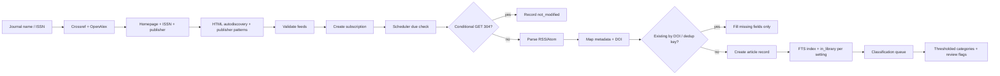
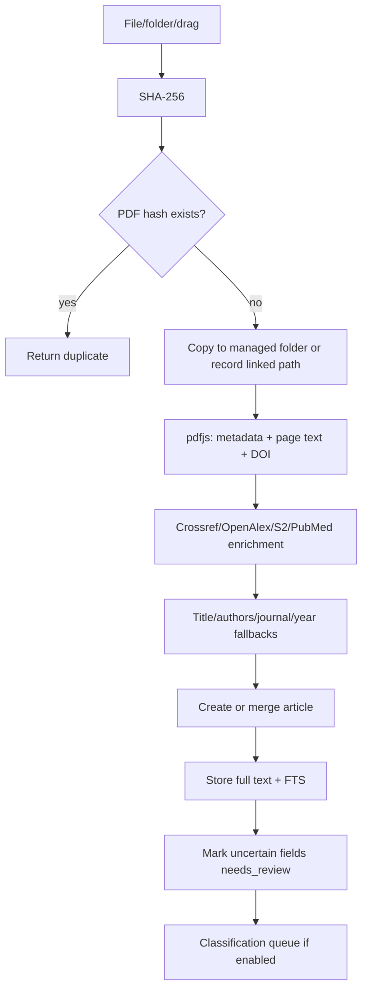
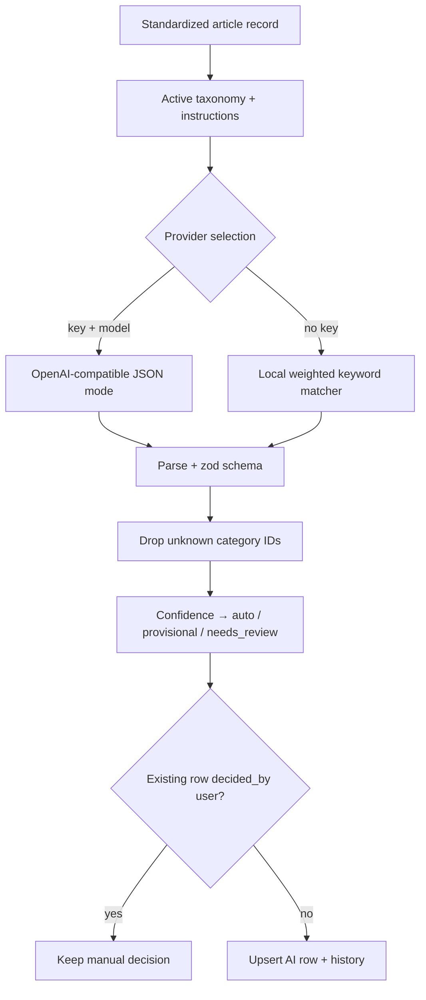
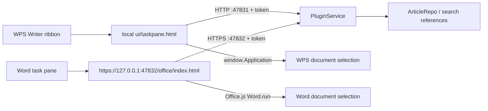

# Architecture

## 1. Context and constraints

LiteratureX is a local-first desktop application. The original master prompt recommended **Tauri 2 + Rust + React**. The build environment used for this implementation had:

- Windows 11 x64, WebView2 installed, Python/Anaconda available;
- **no Node.js, no Rust toolchain, no Visual Studio Build Tools / Windows SDK**.

A Tauri build would require an administrator-level, multi-gigabyte Visual Studio Build Tools installation before the first line of Rust could compile. That is not reliably automatable and would have blocked the entire delivery.

**Decision:** keep the prescribed React + TypeScript + Vite + Tailwind frontend and product architecture, and replace only the desktop shell with **Electron 45** (bundled Node 24.22, SQLite FTS5 available). The app uses **zero native Node modules**, so no MSVC is ever required. The trade-off is a larger installer and higher idle memory than Tauri; the benefit is a fully reproducible, admin-free build with the same capabilities.

This deviation is also documented in `README.md` and `DEVELOPMENT.md`.

## 2. Process model

```
┌────────────────────────────────────────────────────────────────┐
│ Renderer (React 19, sandboxed, no Node)                         │
│  Pages: Dashboard · Discover · Library · Collections ·         │
│         Assistant · Settings                                   │
│  Zustand store · i18n (zh/en) · Tailwind + Radix               │
│  pdfjs-dist PDF canvas preview                                 │
└───────────────────────────┬────────────────────────────────────┘
                            │ typed methods, contextBridge
                            │ ipcRenderer.invoke / app:event
┌───────────────────────────▼────────────────────────────────────┐
│ Preload (sandboxed, no Node)                                    │
│  window.api = { app, articles, categories, subscriptions,       │
│  pdf, assistant, settings, io, jobs, suggestions, groups }      │
└───────────────────────────┬────────────────────────────────────┘
                            │ validated IPC (zod) + main → renderer events
┌───────────────────────────▼────────────────────────────────────┐
│ Main process (Node 24)                                          │
│  AppContext: repositories + services + scheduler + jobs         │
│  SQLite (WAL, FTS5) · PDF files · safeStorage · dialogs        │
│  HTTP providers: Crossref, OpenAlex, S2, PubMed, Unpaywall      │
│  OpenAI-compatible client · local heuristic classifier          │
└────────────────────────────────────────────────────────────────┘
```

- `contextIsolation: true`, `sandbox: true`, `nodeIntegration: false`.
- The renderer never sees API keys, database handles, or arbitrary filesystem access.
- All external links go through `shell.openExternal` with an http(s) check.
- PDF preview bytes are streamed through IPC; no `webSecurity` relaxation and no custom protocol.

## 3. Repository layout

```
src/
  main/
    index.ts                 app lifecycle, window, restore/relaunch
    context.ts               dependency wiring + high-level operations
    ipc.ts                   IPC registration, zod validation, file dialogs
    db/
      database.ts            DatabaseSync, pragmas, migrations, FTS5 probe
      schema.ts              versioned SQL migrations
      repositories/          articles, categories, subscriptions, pdfs,
                             settings, jobs, cache, assistant
    services/
      http.ts                timeout/retry/JSON/text/bytes helpers
      metadata.ts            Crossref/OpenAlex/S2/PubMed/Unpaywall merge
      discovery.ts           journal search, feed discovery & validation
      rss.ts                 parsing, conditional sync, scheduler
      pdf.ts                 hash, storage, pdfjs extraction, OA download
      settings.ts            defaults, deep merge, DPAPI secret storage
      importExport.ts        BibTeX/RIS/CSV/JSON
      backup.ts              VACUUM INTO snapshot + zip + restore staging
      pluginService.ts       loopback HTTP/HTTPS API + WPS/Word add-in installer
      ai/
        providers.ts         provider interface, OpenAI client, heuristic
        classifier.ts        prompt, JSON validation, thresholds, history
        queue.ts             background classification jobs
        assistant.ts         citations, summaries, compare, QA fallback
  preload/index.ts           contextBridge API implementation
  renderer/src/
    App.tsx, store/, i18n/, lib/
    components/ui/           shadcn-style primitives (Radix)
    components/              article bits, detail panel, PDF viewer, dialogs
    pages/                   Dashboard, Discover, Library, Collections,
                             Assistant, Settings
  shared/                    types, constants, normalization helpers
tests/
  unit/ integration/ e2e/ fixtures/
```

## 4. Service responsibilities

| Service | Responsibility |
|---|---|
| `AppDatabase` | Opens SQLite, WAL/busy timeout/FK pragmas, probes FTS5, applies `user_version` migrations, nested transactions via savepoints |
| `ArticleRepo` | Unified record CRUD, dedup keys, authors, notes, FTS maintenance, list/search/stats, manual classification precedence |
| `CategoryRepo` | Hierarchical taxonomy, keywords/synonyms, paths, counts, suggestion storage |
| `SubscriptionRepo` | Journals, feeds, subscriptions, groups, due scheduling, sync history |
| `PdfRepo` / `PdfService` | PDF records, SHA-256 dedup, managed/linked storage, pdfjs text/metadata/DOI, citation-line parsing, OA download |
| `MetadataService` | DOI/title lookup with provider fallback, cache, field-level merge, no fabricated values |
| `DiscoveryService` | Journal candidates, RSS autodiscovery, publisher patterns, feed validation/ranking |
| `RssSyncService` | Conditional GET, item mapping, dedup, missing-field merge, sync history, scheduler |
| `SettingsService` | Defaults, deep merge, encrypted API key, provider config |
| `ClassifierService` | Taxonomy prompt, structured output validation, thresholds, manual-preserving apply, history, suggestions |
| `ClassificationQueue` | Job-backed background classification with progress events |
| `AssistantService` | Context building, citations, AI/offline summarization, comparison, trends, related |
| `ImportExportService` | BibTeX/RIS/CSV/JSON round-trips |
| `BackupService` | `VACUUM INTO` snapshot, ZIP with manifest + managed PDFs, key sanitisation, restore staging |
| `PluginService` | Loopback HTTP/HTTPS citation API, WPS add-in install/uninstall, Word manifest + localhost certificate/HTTPS server |

## 5. Key data flows

### 5.1 RSS → library → classification



### 5.2 PDF import



### 5.3 Classification and manual overrides



### 5.4 Search

- FTS5 table is maintained by the repository whenever an article, author list, note, classification, fulltext, or category name changes.
- Search query builder supports quoted phrases, `AND/OR/NOT`, and a trailing prefix wildcard; special FTS characters are neutralised.
- CJK queries use a SQL `LIKE` fallback across title/abstract/authors/journal/DOI/keywords/summary/notes/fulltext/category names, because the default `unicode61` tokenizer does not segment Chinese into useful terms.
- Ranking uses `bm25()` with field weights; snippets are returned with `<mark>` tags and rendered as highlights.
- Filters are applied with indexed `EXISTS` subqueries. Category filters expand descendants.
- A future vector layer can add an `article_embeddings` table and a hybrid ranker without changing the article model.

## 6. Office / WPS citation add-in

The main process starts a token-protected, loopback-only plugin service:



- **WPS:** a JS add-in folder (`resources/office-plugin/wps`) is copied to `%APPDATA%\kingsoft\wps\jsaddons\LiteratureX_<version>` and registered by merging `publish.xml`. The ribbon button opens a local task pane; the pane reads the token/apiBase from `js/config.js`.
- **Word:** a task-pane manifest is generated at `%APPDATA%\LiteratureX\office-addin\manifest.xml` with `SourceLocation=https://127.0.0.1:47832/office/index.html`. HTTPS is required by Office; a self-signed localhost/IP certificate is generated on explicit install and trusted into the current user's Root store via `certutil -user`. The manifest is sideloaded via Word → Insert → Get Add-ins → Upload My Add-in.
- **Shared UI:** `resources/office-plugin/shared/app.js` performs search, citation formatting (numeric / author-year), citation-state persistence (Word document settings or WPS document variables), and host-specific text insertion.
- **API:** `GET /api/plugin/status|search|references`, all requiring `X-LiteratureX-Token`. Only library articles are exposed. CORS + private-network headers support the WPS `file://` task pane.
- **Security:** servers bind `127.0.0.1` only; the token is a random value stored in `application_settings` (`plugin_token`) and written into the WPS config at install time. Word receives it in the generated page. Reference data never leaves the machine. The certificate is scoped to `localhost`/`127.0.0.1` and only created after explicit confirmation.

See `docs/OFFICE_PLUGIN.md` for install/troubleshooting details.

## 7. Security and privacy
- **Secrets:** API key encrypted with Electron `safeStorage` (DPAPI on Windows). Stored as ciphertext in `ai_model_settings`; never returned by IPC. `SettingsService` strips any `apiKey` field from persisted settings JSON.
- **Plugin token:** random 32-byte token in `application_settings`; required by every plugin API request. WPS add-in config stores it locally; Word receives it via the locally served page.
- **Local TLS:** the Word add-in certificate is generated on demand, covers only `localhost`/`127.0.0.1`, and is trusted only after explicit confirmation in Settings.
- **IPC:** every handler validates ids/payload shape with zod; only http(s) URLs can be opened externally.
- **Renderer:** CSP meta (`default-src 'self'`, worker-src self/blob), sandboxed, no Node integration, no remote content loaded.
- **SQL:** parameterised statements; dynamic `ORDER BY` only from a fixed map; FTS query input is quoted/escaped.
- **Network:** only Crossref, OpenAlex, Semantic Scholar, PubMed, Unpaywall, RSS feed URLs, OA PDF URLs, and the user-configured AI endpoint. No telemetry.
- **Data sent to AI:** title, journal, year, DOI, keywords, abstract, optionally full text and notes? Notes are **not** sent. Full text is opt-in (`ai.sendFullText`, default `false`; assistant has its own `assistant.sendFullText`, default `false`).
- **Destructive actions:** article deletion is a soft delete to Trash; permanent deletion and managed-PDF removal require explicit confirmation. Linked original files are never deleted by the app.

## 8. Reliability and performance

- SQLite WAL + `busy_timeout` + foreign keys + `BEGIN IMMEDIATE` transactions; nested services use savepoints.
- HTTP timeout per request, up to two retries for 5xx/429/network; AI client retries once for 429/5xx.
- Conditional RSS GET; sync history for every attempt; feed error stored and shown.
- Background jobs table; stale `running/queued` jobs are marked error at startup.
- Daily automatic database snapshot (retained 7); manual full ZIP backup with manifest; restore creates a pre-restore snapshot.
- FTS index rebuilt at startup if row counts diverge.
- Indexes on DOI, dedup key, journal, date, read/starred flags, subscription, source, categories, PDFs, notes, sync history.
- Measured on the build machine with 10,000 references: FTS search ≈5–9 ms, paginated list ≈1.5–2.4 ms (`tests/integration/scale.test.ts`).
- Batch hydration avoids N+1 queries for authors/categories/PDFs/notes on list pages.

## 9. Extensibility

- **AI providers:** `AiProvider` interface (`classify`, `chat`, `testConnection`). Adding Anthropic/local proprietary providers only requires a new implementation.
- **Zotero import:** the normalized article/author/category/pdf model already maps directly:
  - Zotero item → `articles`
  - creators → `authors`/`article_authors`
  - collections → `categories` (hierarchy via `parent_id`)
  - attachments → `pdf_files` (managed copy or linked path)
  - tags → `keywords`
  No schema change is required.
- **Semantic search:** add an embedding table + provider interface; keep FTS as lexical recall and rerank.
- **macOS/Linux:** all paths use `app.getPath`, node:sqlite and pdfjs are cross-platform. Add `dmg`/`AppImage` targets and platform icons; no native compilation is involved.

## 10. Deliberate scope choices

- Classification can run fully offline with the heuristic classifier; this makes the application usable and testable without an API key.
- Full-text sending to AI is opt-in for privacy; classification falls back to abstract/title.
- Publisher RSS discovery is best-effort because publisher sites change frequently; manual RSS entry is always available.
- OCR and Zotero import are documented extension points rather than partial placeholders.
