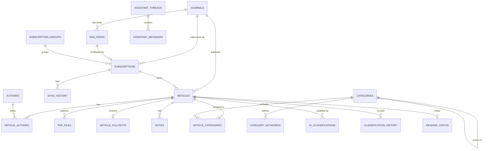

# Database Design

LiteratureX uses a single local SQLite database, opened through Node 24's built-in `node:sqlite` (no native addon). The database file lives at `%APPDATA%\LiteratureX\literaturex.db` by default; tests and portable runs can override the directory with `LITERATUREX_USER_DATA`.

## 1. SQLite configuration

- `PRAGMA journal_mode = WAL`
- `PRAGMA synchronous = NORMAL`
- `PRAGMA foreign_keys = ON`
- `PRAGMA busy_timeout = 5000`
- Schema version tracked with `PRAGMA user_version`; migrations are applied transactionally from `src/main/db/schema.ts`.
- FTS5 availability is probed at startup. Current Electron/Node builds include it; if unavailable, the app creates a plain fallback table and uses `LIKE` search (documented degradation, not silent corruption).

## 2. ER diagram

## 3. Tables

### Core bibliographic layer

| Table | Purpose |
|---|---|
| `journals` | Journal identity: title, ISSN/eISSN, publisher, homepage. ISSN fields are uniquely indexed when present. |
| `rss_feeds` | Feed URL (unique), optional journal link, discovery source, ETag / Last-Modified, last status/error/item count. A synthetic `crossref://journal/<ISSN>` URL represents the Crossref article fallback feed when no publisher RSS/Atom feed exists. |
| `subscriptions` | A user's follow of one feed: custom name, group, enabled flag, sync interval, last sync. Unique per feed. |
| `subscription_groups` | Custom user groups; publisher grouping is derived from `journals.publisher`. |
| `articles` | Unified bibliographic record for RSS metadata, manual references, imports, and PDFs. Includes DOI normalized key, dedup key, soft delete, keywords JSON, AI summary, review flag, metadata confidence/user-edited fields. |
| `authors` | Normalized author identity (`normalized_name` unique). |
| `article_authors` | Ordered many-to-many link (position preserved). |
| `pdf_files` | Files attached to articles: path, managed/linked mode, SHA-256 (unique), size, page count, extraction status/source URL. Independent of `articles`: an article can exist without a PDF and vice versa. |
| `article_fulltexts` | Extracted text and per-page text JSON used for FTS, assistant page citations, and reclassification. |

### Taxonomy and classification

| Table | Purpose |
|---|---|
| `categories` | User-defined hierarchy via `parent_id`; name, description, AI instructions, color/icon, priority, active flag, sort order. |
| `category_keywords` | Keywords and synonyms per category with weight and kind. Unique per category + lower(keyword) + kind. |
| `article_categories` | Assignment join with provenance: `source=ai/manual`, `decided_by=ai/user`, confidence, evidence, reasoning, matched keywords, status (`auto`, `provisional`, `needs_review`, `confirmed`, `rejected`), model/prompt version. Unique per article+category. |
| `ai_classifications` | Raw audit record per classification run: provider, model, prompt version, raw response, parsed JSON, status/error, duration, thresholds. |
| `classification_history` | Append-only audit of assignments/removals/manual changes with actor and before/after JSON. |
| `category_suggestions` | AI/heuristic taxonomy improvement suggestions; user must accept or dismiss. |

### User state and operations

| Table | Purpose |
|---|---|
| `notes` | Multiple notes per article, full-text indexed. |
| `reading_status` | Reading status + last viewed timestamp (mirrored to `articles.read_status` for fast filtering). |
| `sync_history` | Every feed sync attempt: start/finish, status, found/new/updated counts, error. |
| `jobs` | Background job state/progress/results for classification batches (and future background work). |
| `metadata_cache` | TTL cache for external metadata lookups (DOI/title/Unpaywall). |
| `ai_model_settings` | Default provider configuration; encrypted API key ciphertext only. |
| `application_settings` | JSON key/value settings (no secrets). Also stores `plugin_token`, the random token required by the local Office/WPS add-in API. |
| `assistant_threads` | AI assistant conversation metadata. |
| `assistant_messages` | Role, content, citations JSON, timestamps. |
| `article_fts` | FTS5 virtual table: title, abstract, authors, journal, keywords, notes, AI summary, category paths, fulltext, DOI. |

## 4. Key constraints and indexes

- `UNIQUE(doi_normalized) WHERE doi_normalized IS NOT NULL` — one record per DOI.
- `UNIQUE(dedup_key) WHERE doi_normalized IS NULL AND dedup_key IS NOT NULL` — title+journal+year fallback for DOI-less artifacts.
- `dedup_key = normalizeTitle(title) | normalizeJournal(journal) | year`.
- `UNIQUE(pdf_files.sha256)` — duplicate file detection.
- `UNIQUE(rss_feeds.url)` and `UNIQUE(subscriptions.feed_id)`.
- `UNIQUE(categories name?)` is not enforced: users may reuse leaf names in different branches; path is the identity.
- `article_categories UNIQUE(article_id, category_id)` allows an upsert to preserve provenance.
- Indexes: article DOI/dedup, journal, publication date, creation date, library/deleted, read status, starred, subscription, source, normalized title; categories parent; keywords category; assignments article/category/status; PDF article; notes article; sync history subscription/date; jobs status; messages thread/date.

## 5. Manual override semantics

The invariant is: **a human decision always wins**.

- AI upserts skip any row where `source='manual'` or `decided_by='user'`.
- A user rejection is stored as `status='rejected'`, `decided_by='user'`; it is excluded from UI/list/collection queries but remains as a blocker against future AI assignment.
- Manual add sets `source='manual'`, `decided_by='user'`, `status='confirmed'`.
- Accept sets `status='confirmed'`, `decided_by='user'`.
- Reclassification deletes only stale rows with `source='ai' AND decided_by='ai'`.
- Every transition writes `classification_history` with actor/before/after.

## 6. FTS maintenance

`article_fts` is a normal FTS5 table (not external-content) maintained by `ArticleRepo.refreshSearchIndex(articleId)`:

- called after create/update, metadata merge, author changes, note changes, classification changes, fulltext extraction, and category rename/delete;
- deletes and reinserts the row using the article's implicit `rowid`;
- on startup, if `COUNT(articles) != COUNT(article_fts)`, the entire index is rebuilt;
- search uses `bm25()` weights (title 10, abstract 4, authors/journal 2, keywords/summary/categories 2–3, fulltext 1, DOI 5) and `snippet()` for highlighted excerpts.

## 7. Migrations

- `migrations` is an ordered array of `{version, name, sql}`.
- Applied inside a transaction; `PRAGMA user_version` updated after each.
- The current baseline is version 1 (`initial_schema`). Future changes must append a migration; never edit an applied one.
- Backup files include the database and are validated against `manifest.json` plus a non-zero `user_version` before restore.

## 8. Trash, deletion, and files

- Article deletion is soft (`deleted_at`), filtered out by default.
- Empty Trash / permanent delete removes the article row and its `pdf_files` rows, but **does not delete PDF files on disk**. The detail panel offers explicit managed-file deletion only after confirmation.
- Linked originals are never removed.
- Managed PDFs are content-addressed as `pdfs/<sha256[0:2]>/<sha256>.pdf`.

## 9. Backup

- Daily snapshot: `VACUUM INTO backups/auto-YYYY-MM-DD.db`, keeps the latest 7.
- Full backup ZIP: `manifest.json`, `literaturex.db` (API key ciphertext nulled), `pdfs/` (managed files).
- Restore: validate manifest/schema → create a pre-restore snapshot → close DB → replace DB and managed PDF folder → relaunch.
- Linked PDFs are referenced by absolute path in the DB and are not copied into the backup; ensure originals remain available after restoring on another machine.

## 10. Zotero forward compatibility

The schema intentionally maps 1:1 to Zotero concepts:

| Zotero | LiteratureX |
|---|---|
| Item | `articles` |
| Creator | `authors` + `article_authors.position` |
| Collection (nested) | `categories.parent_id` |
| Tag | `articles.keywords` (JSON array) |
| Attachment | `pdf_files` (managed or linked) |
| Item note | `notes` |
| Date added/modified | `created_at` / `updated_at` |

A future importer can stream Zotero SQLite/JSON exports into these tables without a schema migration.
