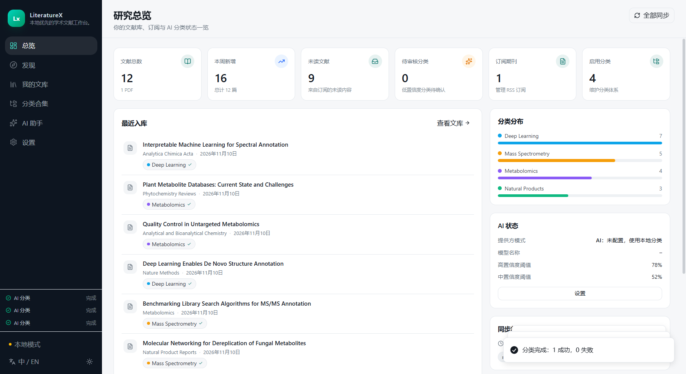
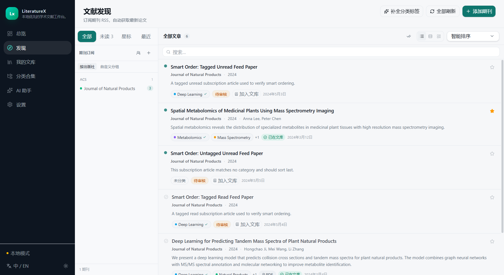
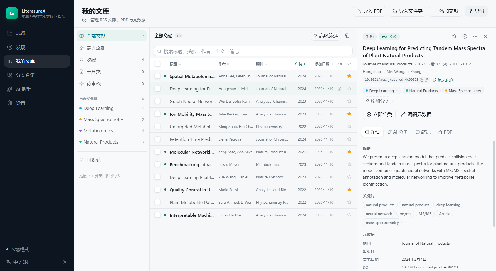
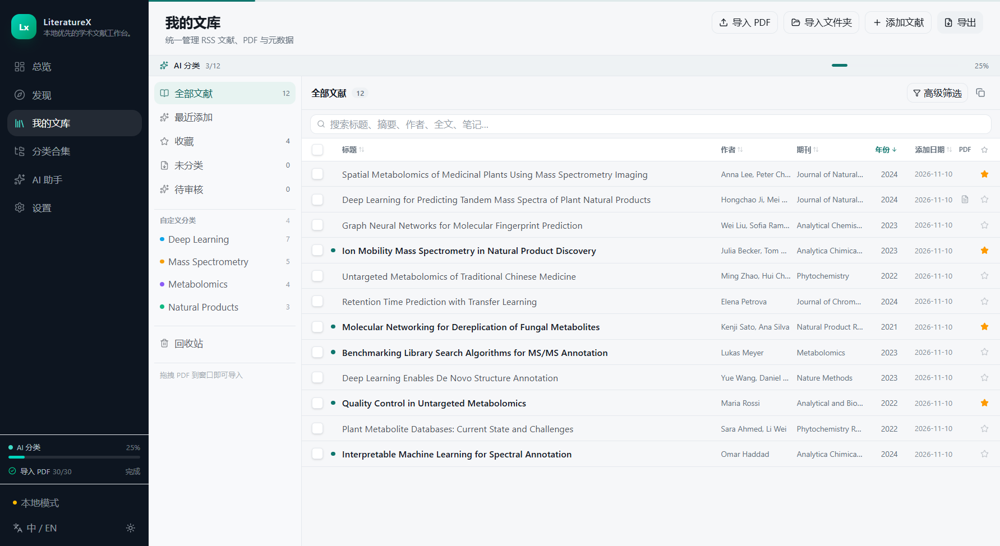
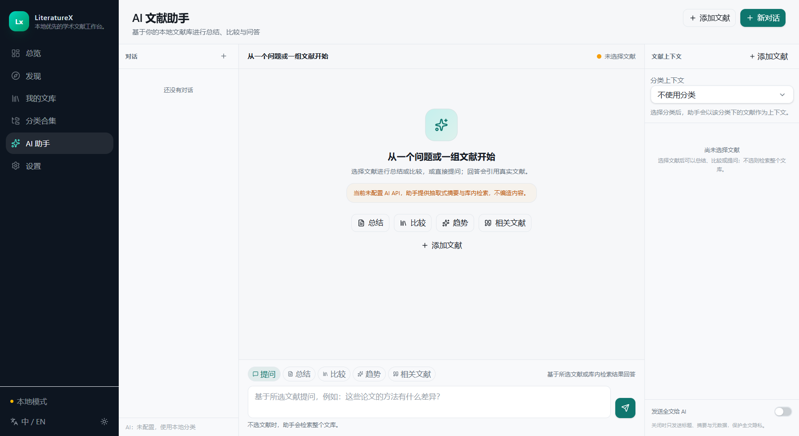
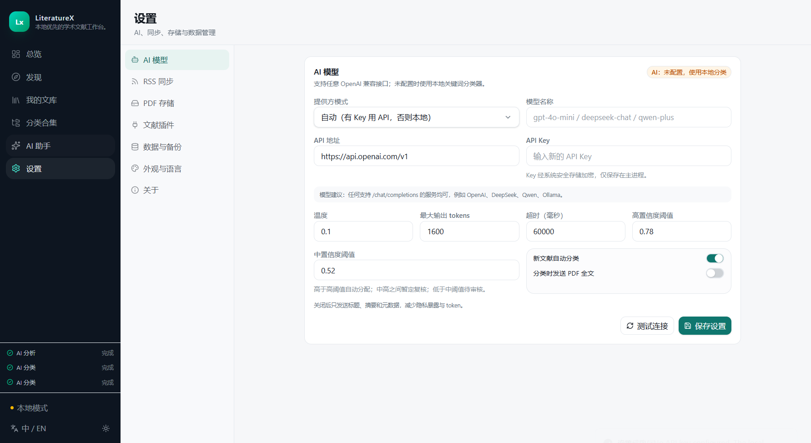

# LiteratureX

LiteratureX 是一个**本地优先的 AI 文献工作台**，把期刊 RSS 发现、Zotero 式文献库、PDF 管理、用户自定义层级分类体系与 AI 多标签分类整合在一个桌面应用中。

> Local-first academic literature intelligence: journal RSS discovery → article collection → AI classification → unified library → search → AI assistant.

GitHub: <https://github.com/hcji/LiteratureX>  
网站：<https://hcji.github.io/LiteratureX/>

Windows 10/11 x64 安装包与便携版：[最新 Release](https://github.com/hcji/LiteratureX/releases/latest)



## 功能

### 文献发现（Discover）
- 按期刊名称 / ISSN 搜索期刊（Crossref + OpenAlex）。
- 自动发现 RSS/Atom 源：官网 `<link rel="alternate">` autodiscovery、出版社模板、ISSN 端点、常见路径，并逐条抓取验证。
- 手动输入 RSS 地址作为兜底；没有可靠源时明确提示。
- 订阅管理：自定义分组、出版社分组、同步频率、启停、手动刷新。
- 后台增量同步：ETag/Last-Modified 条件请求、按 DOI / 标题去重、只补全缺失字段、同步历史与错误记录。
- 同步后的订阅文章自动分类打标签；发现页默认“智能排序”：未读优先，已分类在前，未匹配分类的靠后。
- 三视图 Feed（列表 / 紧凑 / 详情）、已读/未读、星标、原文链接、开放获取 PDF 下载。



### 文献库（My Library）
- 统一记录 RSS 元数据、手动引用、BibTeX/RIS/JSON 导入与 PDF。
- 单文件 / 多文件 / 文件夹 / 拖拽导入 PDF；SHA-256 去重。
- pdf.js 文本与元数据提取、DOI 识别、Crossref/OpenAlex/Semantic Scholar/PubMed 元数据补全。
- 托管存储（复制到应用目录）或链接存储（保留原位置）；删除文件需显式确认。
- 三栏布局、可点击表头排序（标题/作者/期刊/年份/添加日期）、排序、筛选、多选、批量操作、软删除回收站。
- 双击文献行在内置 PDF 阅读器中打开（连续滚动、缩放、适应宽度）；右键可改用系统应用打开；无 PDF 时回退到出版社页面或 DOI。
- 右侧元数据栏可收起/显示；分类支持多选合并，并由 LLM 生成合并后的名称、描述与关键词。
- 元数据编辑、笔记、阅读状态、收藏、PDF 预览。
- 长耗时操作（PDF 导入、分类、LLM 整理、RSS 同步、备份等）在侧边栏任务列表、顶部进度条和页面内联进度中显示百分比或完成状态。



### 用户自定义 AI 分类（Collections）
- 任意层级分类树：名称、描述、关键词、同义词、分类指令、优先级、颜色、启停。
- AI 多标签分类，返回结构化 JSON：分类、置信度、证据、匹配关键词、理由、摘要、未匹配主题、是否需人工复核。
- 高/中/低置信度策略与可配置阈值。
- 审核队列、证据展示、分类历史；人工接受/拒绝/手动增删。
- **人工修正不会被后续同步或重分类覆盖**。
- 单篇 / 批量 / 全库重分类，后台任务进度。
- **LLM 自动整理**：处理全部未分类文献；可设置最多新增类别数、用于生成新类别的抽样条数、是否发送全文（默认只发送题目与摘要）以及思考深度（默认中低）。新类别仅由抽样文献产生，低置信度分类会标记复核。
- AI 分类体系改进建议（仅建议，用户确认后才创建分类/关键词）。



### 搜索与 AI 助手
- SQLite FTS5 统一检索：标题、摘要、作者、期刊、DOI、关键词、全文、AI 摘要、分类名、笔记。
- 布尔/短语/前缀查询、筛选、bm25 相关性排序、命中片段高亮。
- AI 助手：选文摘要、结构抽取、多文比较、库内问答、相关文献、趋势分析。
- 引用映射到真实库内文献，区分论文证据与 AI 推断；全文发送默认关闭。
- 无 API Key 时提供抽取式摘要、库内检索和统计兜底，不编造内容。



### 数据与设置
- OpenAI 兼容 API 配置（endpoint / model / key），Key 使用操作系统安全存储（Windows DPAPI）加密。
- RSS、存储、外观（中英文 / 明暗主题）设置。
- BibTeX / RIS / CSV / JSON 导入导出；数据库 + 托管 PDF 完整备份与恢复；每日自动数据库快照。
- 仪表盘：总量、本周新增、未读、待审核、订阅期刊、分类分布、来源、同步状态。



### WPS / Microsoft Word 文献插件
- 在 **设置 → 文献插件** 一键安装/更新 WPS Writer 加载项，并生成 Microsoft Word 的 Office.js 加载项。
- 任务窗格直接搜索本地 LiteratureX 文库，插入数字引用 `[1]` 或作者-年份引用，并在文末生成参考文献表。
- WPS 使用本地 `127.0.0.1:47831` HTTP 服务；Word 使用本机 HTTPS `127.0.0.1:47832` 和一次性信任的本地证书。
- 引用编号/已引用文献保存在文档设置或文档变量中，关闭再打开仍可继续更新。
- 插件服务使用随机令牌、仅监听回环地址，文献数据不离开本机。


安装与故障排查见 [docs/OFFICE_PLUGIN.md](docs/OFFICE_PLUGIN.md)。

## 技术栈

| 层 | 技术 |
|---|---|
| 桌面壳 | Electron 45（内置 Node 24.22） |
| 前端 | React 19 + TypeScript + Vite 8 + Tailwind CSS 4 + Radix primitives（shadcn 风格组件） |
| 主进程 | Node/TypeScript 服务层；`contextIsolation` + `sandbox` + preload 类型化 IPC |
| 数据库 | SQLite（`node:sqlite`，零原生模块） + FTS5 + 版本化迁移 |
| PDF | pdfjs-dist（主进程文本提取；渲染进程连续滚动阅读器） |
| RSS | rss-parser + cheerio |
| AI | OpenAI 兼容 `/chat/completions` + 本地启发式分类器 |
| 测试 | Vitest（单元/集成）+ Playwright（Electron E2E） |
| 打包 | electron-builder（NSIS 安装包 + portable） |

## 快速开始（开发）

本仓库自带便携 Node 引导脚本，不需要管理员权限：

```bat
git clone https://github.com/hcji/LiteratureX.git
cd LiteratureX
python scripts\bootstrap_node.py
set "PATH=%CD%\.tools\node;%PATH%"
npm install
npm run dev
```

首次安装若 Electron 二进制未下载（新版 npm 可能阻止 postinstall）：

```bat
set "PATH=%CD%\.tools\node;%PATH%"
set "ELECTRON_MIRROR=https://npmmirror.com/mirrors/electron/"
node node_modules\electron\install.js
```

### 常用命令

```bat
npm run typecheck     # 主进程 + 渲染进程类型检查
npm test              # Vitest 单元/集成测试
npm run test:e2e      # 构建后运行 Playwright Electron E2E
npm run build         # 生产构建（out/）
npm run dist:dir      # 开发验证：只生成 release/win-unpacked，并删除旧安装 exe
npm run release:unpacked  # 同 dist:dir
npm run dist:win      # 正式发布时才生成 NSIS 安装包与 portable exe
```

## 数据位置

默认位于 `%APPDATA%\LiteratureX`：

- `literaturex.db` — SQLite 数据库
- `pdfs/` — 托管 PDF
- `backups/` — 每日自动数据库快照

可通过环境变量覆盖用户数据目录（用于测试/便携）：

```bat
set "LITERATUREX_USER_DATA=E:\LitXData"
```

## 配置 AI

1. 打开 **设置 → AI 模型**。
2. 模式选择：
   - **自动**：有 API Key 用远程模型，否则本地分类器；
   - **仅 OpenAI 兼容 API**：强制远程；
   - **仅本地启发式**：完全离线。
3. 填写 API 地址（如 `https://api.openai.com/v1`、`http://127.0.0.1:11434/v1`）、模型名称与 API Key。
4. 保存并测试连接。

Key 只在主进程解密，不进入渲染进程、不写入日志；数据库备份会移除加密 Key。

隐私默认值：分类与助手**默认不发送 PDF 全文**，只发送标题、摘要、关键词和元数据；可在设置中显式开启全文发送。

## 验收标准对照

| # | 要求 | 实现 |
|---|---|---|
| 1 | 输入期刊名发现 RSS | Discover → 添加期刊（自动发现 + 手动 URL） |
| 2 | 订阅多个期刊 | 订阅管理 + 分组 + 频率 |
| 3 | 同步并展示新文章 | 后台调度 + 条件请求 + Feed 三视图 |
| 4 | 文章保存进统一库 | RSS 自动入库 / 手动「加入文库」 |
| 5 | 导入现有 PDF | 单/多/文件夹/拖拽 |
| 6 | 提取基础元数据 | pdf.js + DOI 识别 + 外部元数据聚合 |
| 7 | 创建层级分类体系 | Collections 分类树编辑器 |
| 8 | AI 多标签分类 | 远程 API + 本地启发式 |
| 9 | RSS 与 PDF 都能分类 | 统一分类服务与队列 |
| 10 | 人工修正分类 | 接受/拒绝/手动增删 |
| 11 | 人工修正被保留 | `decided_by='user'` 永不覆盖 |
| 12 | 全库搜索 | FTS5 + 过滤 + 排序 |
| 13 | 重启后数据持久化 | SQLite + E2E 重启验证 |
| 14 | 可打包启动 | electron-builder NSIS/portable |

## 测试

```bat
npm test
npm run test:e2e
```

- 57 个 Vitest 用例：迁移/CRUD、去重、FTS、人工覆盖、PDF 提取、RSS 同步、Crossref 期刊回退源、期刊发现、导入导出、备份恢复、助手兜底、OpenAI 模拟响应、分类合并、智能排序、1 万条性能、Office/WPS 插件服务。
- Playwright E2E：分类创建 → PDF 导入 → AI 分类 → 人工纠错 → 全文搜索 → 高级筛选 → RSS 手动订阅同步 → 重启持久化 → PDF 预览 → 表头排序/内置阅读器 → 助手引用 → 设置/主题/语言 → 插件服务/WPS 安装。
- 1 万条文献性能：FTS 搜索约 5–9ms、分页查询约 2ms（开发机）。

## 已知限制

- 安装包未做代码签名，Windows SmartScreen 可能提示。
- macOS/Linux 代码路径已保持跨平台，但当前只构建/验证 Windows。
- Word 加载项使用本地 HTTPS 自签名证书与 Office.js CDN；需要用户显式信任证书并在 Word 中 sideload manifest。当前环境未安装 Word，未做 Word 内最终交互验证。
- WPS 加载项安装后需要完全重启 WPS；WPS 的企业策略或 `oem.ini` 可能禁用第三方 JS 加载项。
- 扫描版 PDF 不做 OCR；无文本时会标记 `unavailable`。
- 出版社 RSS 形态差异很大，自动发现失败时使用手动 RSS 地址。
- Zotero 导入、语义/向量检索为设计好的扩展点，尚未实现。
- 外部元数据 API 的可用性、限流与返回质量由服务方决定；失败时保留本地提取结果并提示复核。

## 文档

- [WPS / Word 文献插件安装与限制](docs/OFFICE_PLUGIN.md)
- [GitHub Releases](https://github.com/hcji/LiteratureX/releases)
- [项目网站](https://hcji.github.io/LiteratureX/)

## License

MIT
